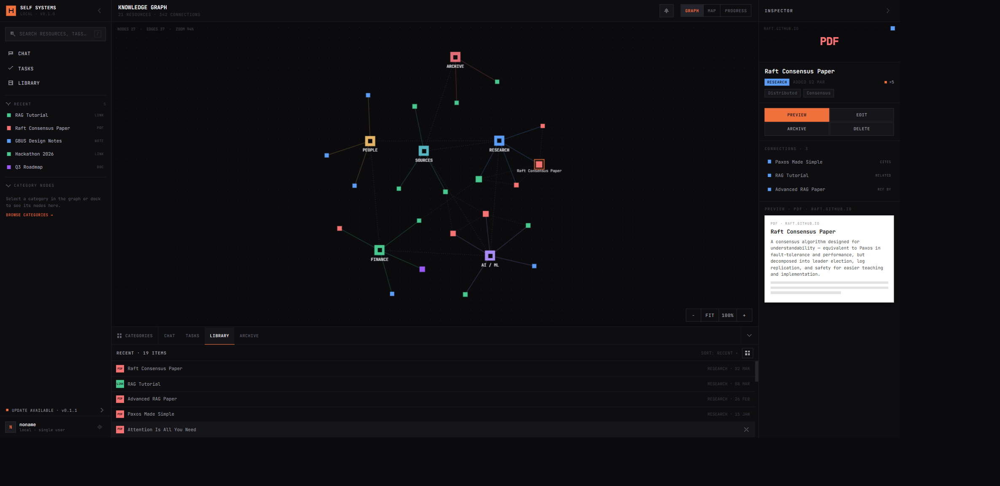
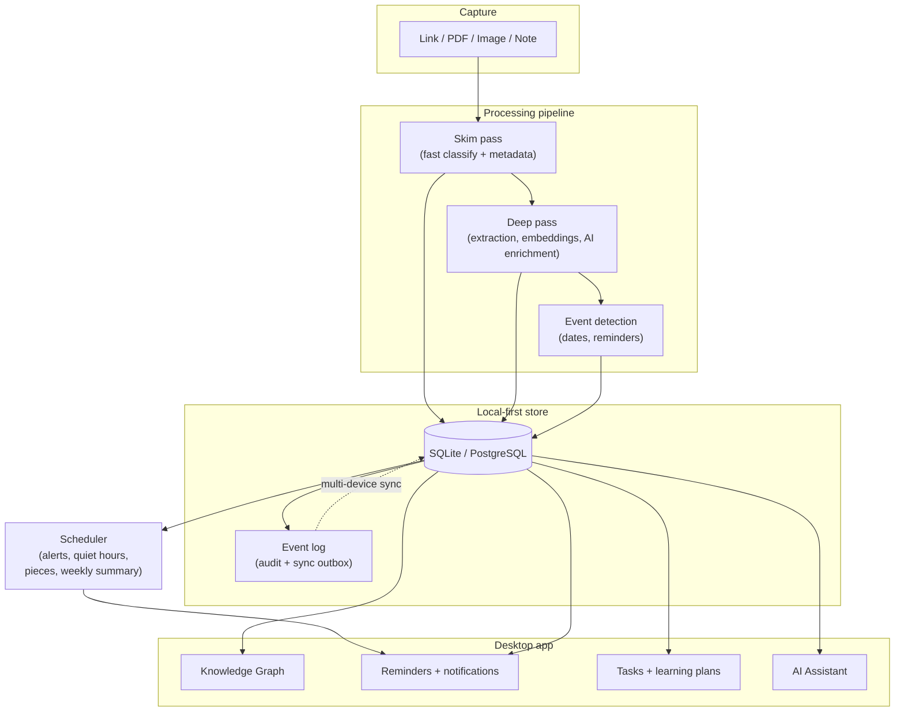

# Self Systems

A local-first personal knowledge system. Capture anything — links, PDFs, images, notes — and it gets extracted, classified, embedded, and connected into a navigable knowledge graph.

## What it does

Most tools that save things for you make *you* do the filing — tags, folders, manual sorting. Self Systems reads what you save, classifies it, and connects it to everything else you've saved, so the organizing happens on its own.

Four things it handles:

- **Memory** — every saved resource lands in a graph, linked by similarity and category, not folders.
- **Reminders** — dates and events mentioned in what you save are picked up automatically.
- **Tasks** — a to-do list that can be derived from what you've saved, not just typed in.
- **Assistant** — a chat interface over all of it: ask questions, find related resources, manage tasks.

### It manages things over time, not just stores them

Once you hand something over, the app keeps track of it so you don't have to:

- **Alerts that actually fire** — reminders and to-do deadlines arrive as in-app and Windows notifications, with a heads-up the evening before. Done, snooze, or open them straight from the alert. Anything due while the app was closed shows up when you return, never lost.
- **No spam** — quiet hours are asked once, then the app suggests better ones from when you're actually active (it never changes them on its own). Several alerts at once arrive as one.
- **Learn a big thing in small pieces** — pick "Learn this" on a saved book or PDF and it's split into chapters and delivered one piece per day on your schedule, remembering where you are. Miss a few days and you get the next piece, not a pile.
- **Weekly summary** — what you finished, what's still open or overdue, what's coming up, and how far along each learning plan is.

Next: AI-written summaries and quiz questions for each piece, and plain-language requests in chat ("remind me one chapter a day from this book").

## How it fits together

Everything runs locally by default — no account, no required API key. Cloud AI providers (OpenAI, Anthropic, Gemini) are optional and swap in behind a heuristic fallback that works offline.

## Stack

Go · React + TypeScript · SQLite / PostgreSQL · Wails desktop shell

## Status

Active development. Source is kept in a private repository — this repo is a public showcase of the project.

## License

See [LICENSE](LICENSE).
